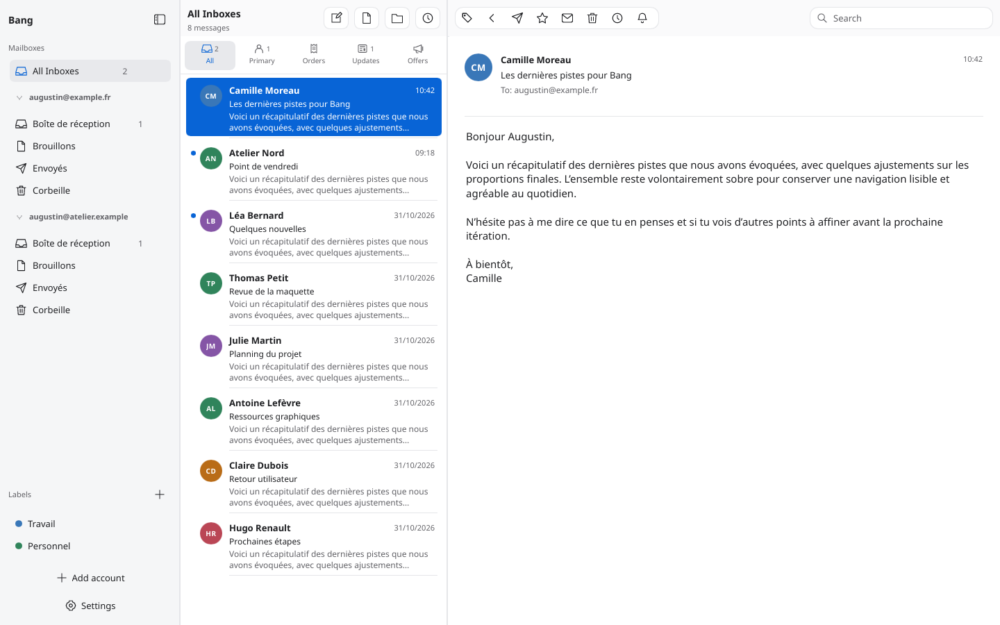
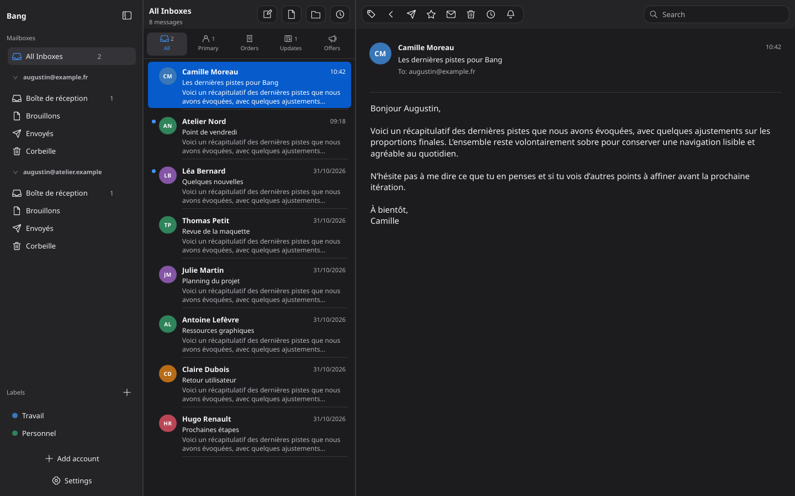

# Bang

[](https://github.com/augustin-laurent/Bang/actions/workflows/ci.yml)
[](LICENSE)


A desktop mail client for Linux, written in Rust, with a Mail macOS 26-inspired interface adapted to Linux.

- **UI**: [Slint](https://slint.dev) (Slint chrome in a GTK3 host, embedded WebKit HTML reader; isolated local rich composer)
- **Engine**: IMAP (per-account syncer thread, IDLE push) + SMTP, SQLite cache, OAuth2 (Gmail/Microsoft) and generic IMAP/SMTP accounts
- **Status**: early development — see [PLAN.md](PLAN.md) for the roadmap



<details>
<summary>Dark appearance</summary>



</details>

These are captures of the running Slint UI using fictional offline data, not design mockups.

## Install

Bang is experimental pre-1.0 software. Packages target **Linux x86_64**:
Ubuntu 26.04, Fedora 45, and current Arch Linux. Other distributions and older
versions have not been validated. The first `v0.1.0` prerelease is being prepared;
packages appear in [GitHub Releases](https://github.com/augustin-laurent/Bang/releases)
only after the manual Google OAuth release checks pass.

Download the matching package and `SHA256SUMS` from the same release. Verify it:

```sh
# Run in the download directory; select the checksum for your downloaded file.
grep '  bang_0.1.0-1_amd64.deb$' SHA256SUMS | sha256sum --check
sudo apt install ./bang_0.1.0-1_amd64.deb      # Ubuntu 26.04
sudo dnf install ./bang-0.1.0-1.fc45.x86_64.rpm # Fedora 45
sudo pacman -U ./bang-0.1.0-1-x86_64.pkg.tar.zst # Arch
bang
```

For RPM and Arch, select their filenames from `SHA256SUMS` instead. Package managers
install runtime dependencies, including WebKitGTK. No keyring provider is installed
by Bang. Persistent credentials require the session’s configured Secret Service
provider, such as KWallet/KSecretD, GNOME Keyring or KeePassXC (with its integration
enabled). Without one, choose session-only sign-in. See the
[setup requirements](docs/ACCOUNTS.md#fournisseur-secret-service). Node.js and Rust are
only required when building from source. The release also includes a source
archive and checksum-pinned Arch `PKGBUILD`; no AUR package is published.

Google's publisher parameter is not stored in the repository. Google is enabled
in release builds through the publisher’s GitHub Actions secret; unconfigured
source/CI builds keep its sign-in button disabled. Microsoft uses a bundled public
Desktop client registration. Both providers still require live consent checks; generic
IMAP/SMTP and iCloud app-password setup are also supported. See
[account setup](docs/ACCOUNTS.md) and [release preparation](docs/RELEASING.md).

## Features

- Three-pane layout (folders, message list, reading pane) with a unified inbox
  across all accounts.
- Sender photos/logos with colored initials, a local avatar cache and an online-avatar setting.
- Local inbox categories (Primary, Transactions, Updates, Promotions), message/sender corrections,
  and custom colored labels shared across accounts on this device.
- Multiple accounts: OAuth2 (Gmail/Microsoft) or generic IMAP/SMTP.
- Read/unread, star, and delete, with per-folder unread badges.
- Rich compose with fonts, size, bold/italic/underline, colors, highlighting,
  links, lists, alignment and native file attachments. HTML and plain-text MIME alternatives.
- Full-text search across all accounts; French/English interface and locale-aware dates.
- Light/dark/system theme, desktop notifications for new mail, and a settings
  dialog for theme and account management.

## Keyboard shortcuts

| Key | Action |
|-----|--------|
| `j` / `↓` | Next message |
| `k` / `↑` | Previous message |
| `Home` / `End` | First / last message |
| `s` | Toggle star |
| `u` | Toggle read / unread |
| `d` | Delete |
| `Ctrl+N` | New message |
| `Ctrl+F` | Focus search |
| `Ctrl+Q` | Quit |
| `Esc` | Close reading pane / sidebar |

Single-letter actions apply to the selected message and are ignored while a
text field has focus.

## Documentation

- [docs/ARCHITECTURE.md](docs/ARCHITECTURE.md) — how the code is organized and how data flows
- [docs/DEVELOPMENT.md](docs/DEVELOPMENT.md) — build, test, conventions, and Slint gotchas
- [CONTRIBUTING.md](CONTRIBUTING.md) — contributing and pull requests
- [docs/RELEASING.md](docs/RELEASING.md) — packages and release checklist
- [Discussions](https://github.com/augustin-laurent/Bang/discussions) — questions and ideas
- [Issues](https://github.com/augustin-laurent/Bang/issues/new/choose) — reproducible bugs and feature requests
- [SECURITY.md](SECURITY.md) — private vulnerability reporting

## Build

```sh
./scripts/dev.sh # rebuild and launch the optimized app

# Manual build, after installing the Linux packages in docs/DEVELOPMENT.md:
npm ci --prefix crates/composer/web
npm run build --prefix crates/composer/web
cargo build --workspace --release
./target/release/app
```

The main window uses Slint’s software renderer inside GTK3, with WebKitGTK 4.1
for the embedded HTML reader. Remote message images load only after a click;
embedded CID images are local. The isolated rich composer loads only bundled assets. See
[docs/DEVELOPMENT.md](docs/DEVELOPMENT.md) for distribution packages.

## Account sign-in

Google uses browser-based OAuth when a distributor supplies the complete Desktop
registration at build time; end users never create an OAuth app or edit configuration.
Microsoft uses a bundled public Desktop registration and browser-based OAuth with
PKCE, without a client secret. Enter the mailbox address before continuing in the
browser. Live Microsoft account and tenant-policy compatibility remain unverified.

iCloud uses a guided app-password form. Other accounts discover the domain’s
published IMAP/SMTP settings before offering manual configuration. Both mail
transports are checked before saving, without sending a message.

Credentials are saved in the Linux session’s Secret Service keyring, separately
from the mail cache. OAuth tokens renew automatically. If secure storage is
unavailable, users can explicitly continue for this session and sign in again
on the next launch. Cached mail remains available when an account needs reconnecting.

See [docs/ACCOUNTS.md](docs/ACCOUNTS.md) for user steps, publisher registration,
secure-storage behavior, migrations and release checks.

## Layout

- `crates/bang-core` — mail engine (IMAP, SMTP, OAuth, sync, SQLite store). No UI dependencies.
- `crates/app` — Slint UI + tokio/Slint bridge.
- `crates/composer` — isolated GTK/WebKit host and local TypeScript/Tiptap editor.
- `assets/design/` — accepted visual references; `assets/fonts/` — bundled OFL fonts.
- `docs/` — architecture, design and development notes.

## License

Bang is licensed under [MIT](LICENSE). Bundled Noto Sans fonts use the
[SIL Open Font License](assets/fonts/OFL.txt).
